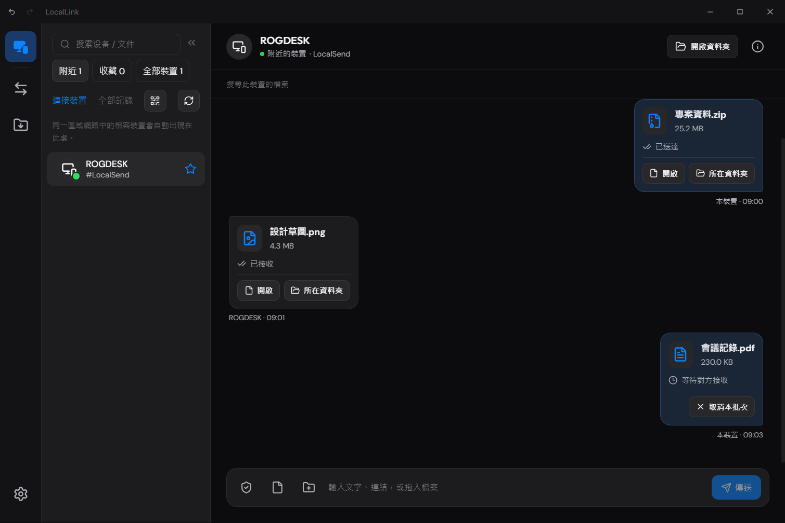
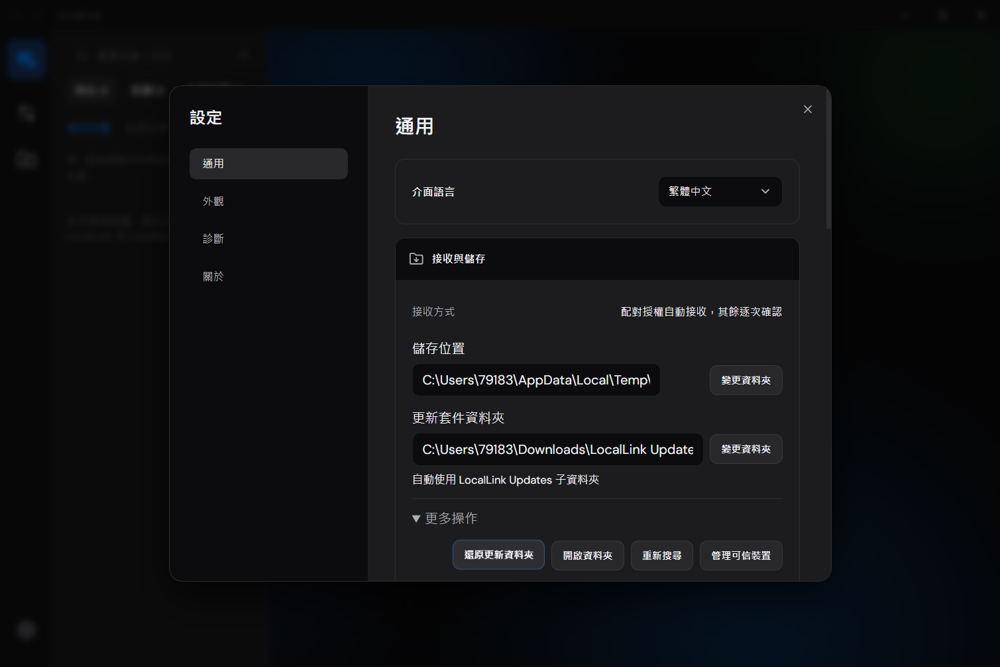

# LocalLink

[繁體中文](README.zh-TW.md)

LocalLink shares files, folders and text across a local network. **Desktop preview 1.0.2** is available for Windows x64 and macOS.

## Download

Choose a package from the [1.0.2 release](https://github.com/MostimaJK/LocalLink/releases/tag/v1.0.2).

| Computer | Package |
| --- | --- |
| Windows x64 | `LocalLink-Setup-1.0.2.exe` or `LocalLink-1.0.2-Portable.exe` |
| Mac with Apple silicon | `LocalLink-1.0.2-arm64.dmg` |
| Intel Mac | `LocalLink-1.0.2-x64.dmg` |

The release includes SHA256SUMS.txt for all four packages. Windows builds are unsigned. Mac builds use ad-hoc signatures and have not been notarized by Apple. On Mac, open the matching DMG and drag LocalLink to Applications.

Folder transfers now show scan and packing progress and support cancellation. If nearby discovery is unavailable, open **Connect device** to copy the address and port for a manual connection. [Release notes](docs/RELEASE-NOTES-1.0.2.md)

## Features

Nearby discovery, favorites, aliases, files, images, folders as ZIP and native LocalLink text. Includes progress, cancellation, retry, history, backups, receive-folder selection, pairing, authorized auto-receive, bandwidth limits and Windows adapter information.

File sizes are limited by available storage and system limits. English is the default for new profiles. Traditional Chinese and Simplified Chinese are available in Settings → General. Existing preferences are preserved.

## Screenshots

Traditional Chinese interface with demonstration data:




## Run from source

```powershell
git clone https://github.com/MostimaJK/LocalLink.git
cd LocalLink
npm --prefix desktop ci
npm start
```

Windows users can also run `Start-LocalLink.bat`.

## macOS development preview

On a Mac, use the source commands above. To build a disk image for the current CPU, run
`npm run desktop:build:mac -- --arm64` on Apple Silicon or `npm run desktop:build:mac -- --x64` on Intel.

The manual **Build and test macOS candidates** workflow builds on both architectures, mounts each DMG and exercises file transfers from the packaged app. Its artifacts are development candidates. Physical LAN discovery and Mac–Windows interoperability still need a two-device test.

## Limitations

100 files per batch, 10,000 folder entries. ZIP needs extra disk space. Retry starts over; no resume in the default protocol. Calls remain in the legacy transport. Tested with 600 MiB loopback transfer, not 50 GB or full physical cross-platform validation. No mobile binaries.

## Licensing

Based on Orbit, inspired by LocalSend; no official affiliation. Retained [MIT license](LICENSE), [dependency notices](desktop/THIRD-PARTY-NOTICES.txt) and [security policy](SECURITY.md). See the [1.0.2 release notes](docs/RELEASE-NOTES-1.0.2.md).
