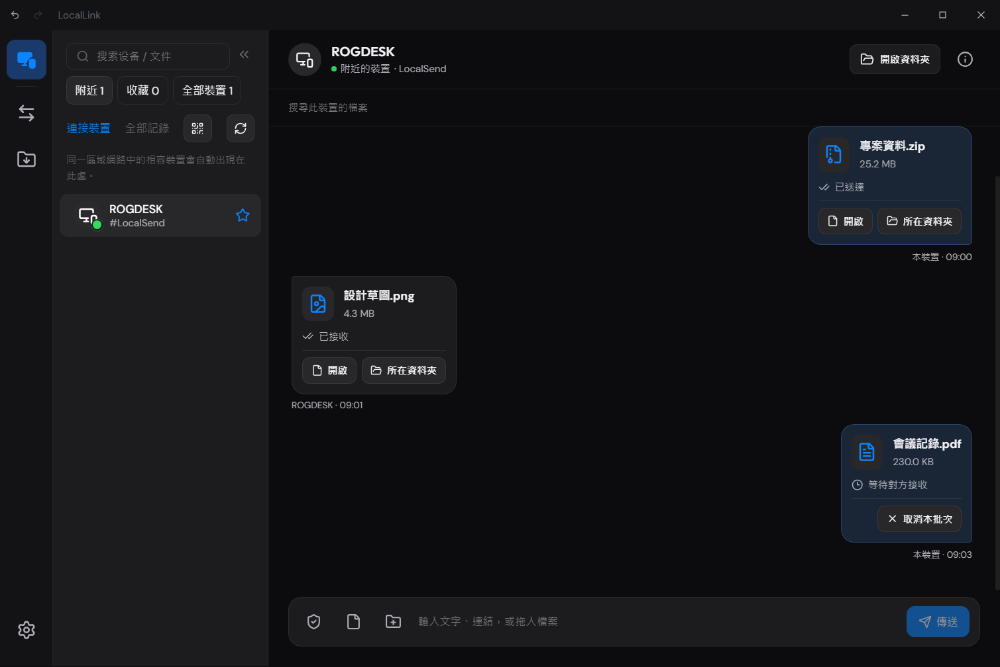
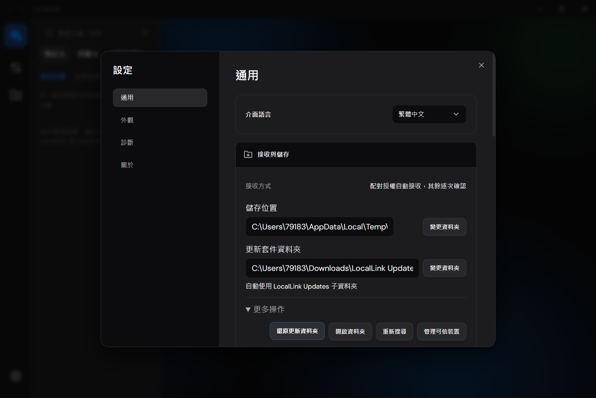

# LocalLink

[English](README.md)

LocalLink 透過區域網路分享檔案、資料夾和文字。**桌面版 1.0.5** 支援 Windows x64、Apple Silicon Mac 與 Intel Mac。

## 下載

請從 [1.0.5 發行頁](https://github.com/MostimaJK/LocalLink/releases/tag/v1.0.5) 選擇套件。Windows 可選 Setup 安裝版或 Portable 免安裝版。Apple Silicon Mac 請選 arm64.dmg，Intel Mac 請選 x64.dmg，開啟後將 LocalLink 拖入「應用程式」。

SHA256SUMS.txt 列出四個套件的校驗值。Windows 版本尚未簽章，Mac 版本採臨時簽章，尚未經 Apple 公證。

## 功能

傳送資料夾時可查看掃描與打包進度，並在上傳前取消。附近裝置探索暫時無法使用時，可在「連接裝置」複製本機位址與連接埠，改用手動連線。詳見[發行說明](docs/RELEASE-NOTES-1.0.5.md)。

附近裝置探索、收藏與備註；檔案、圖片、資料夾 ZIP 與文字；進度、取消、重試、歷史、備份、接收目錄、配對授權、收發限速及網卡資訊。

不設固定容量上限，仍受磁碟與系統限制。新使用者預設英文，可在 **Settings → General → Interface language → 繁體中文** 切換。既有偏好保留，亦支援簡體中文。

## 介面預覽

以下為示範資料。




## 執行原始碼

```powershell
git clone https://github.com/MostimaJK/LocalLink.git
cd LocalLink
npm --prefix desktop ci
npm start
```

Windows 亦可執行 Start-LocalLink.bat。

點選「與手機互傳」，用手機掃碼後輸入電腦上顯示的六位配對碼。預設最多八個瀏覽器可在 15 分鐘內掃同一個碼加入臨時群組。可在開始前取消多台手機共享。群組可傳送文字，檔案由電腦中轉，各接收者自行接受或拒絕。所有已配對的手機都能下載電腦選取的檔案，各手機的上傳請求分別確認。收起 QR 面板後仍可從標題列選擇檔案或管理共享。未配對的 QR 碼於 15 分鐘後失效；配對後可持續互傳，直到按「結束共享」或完全退出 LocalLink。最小化或隱藏到系統匣時仍可繼續傳輸。每次最多上傳 100 個檔案，合計 1 GiB。

部署 HTTPS 時，在啟動前將 `LOCALLINK_SHARE_HOST` 設為手機可解析至所選區域網路位址的主機名稱，`LOCALLINK_SHARE_CERT` 設為 PEM 憑證鏈路徑，`LOCALLINK_SHARE_KEY` 設為 PEM 私鑰路徑。手機須信任簽發機構。設定有誤時無法啟動共享。尚未設定 TLS 時，每次使用未加密 HTTP 都需手動確認，僅適合在可信任的私人網路傳送非敏感檔案。

在 Windows 開發時可用 `npm start` 直接測試變更。`npm --prefix desktop run test:windows:preflight` 會檢查檔案處理、裝置探索復原及更新流程。需要安裝版與免安裝版時，執行 `npm --prefix desktop run build:win:both` 即可共用一次應用程式封裝，兩個成品位於 `desktop/dist/windows/`。

## macOS 開發預覽

在 Mac 上可使用上述原始碼啟動指令。Apple Silicon 使用 `npm run desktop:build:mac -- --arm64` 建立磁碟映像，Intel 使用 `npm run desktop:build:mac -- --x64`。

手動工作流程 **Build and test macOS candidates** 會分別建置兩種架構、掛載 DMG，並從封裝後的程式測試檔案收發。區域網路探索及 Mac 與 Windows 之間的互通仍待雙機驗證。

## 限制

每批 100 個檔案、資料夾 10000 個項目；ZIP 需要額外空間。重試從頭傳送，預設協定尚無斷點續傳，通話仍在舊協定。已驗證 600 MiB 本機傳輸，未做 50 GB 或完整跨平台實機驗收。本次提供 Windows x64 與兩種 Mac 架構的桌面程式。

基於 Orbit 開發，靈感來自 LocalSend，無官方關聯。保留 [MIT 授權](LICENSE) 與 [第三方聲明](desktop/THIRD-PARTY-NOTICES.txt)。
